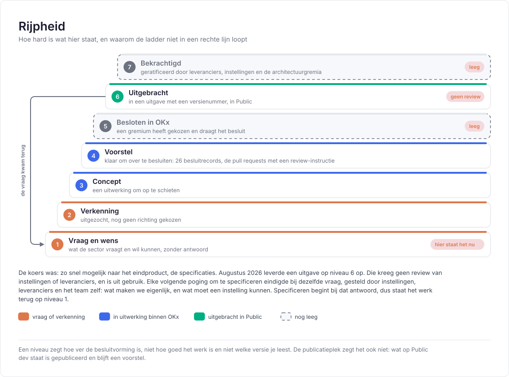

# Rijpheid

Deze repository draagt werk in alle stadia: een vraag die net is opgeschreven staat naast een uitwerking waar maanden in zit. Zonder aanduiding leest dat hetzelfde, en wordt een schets gelezen als een besluit.

## De terugloop

De ladder loopt niet in een rechte lijn, en dat is de kern van het verhaal.

De koers was: zo snel mogelijk naar het eindproduct, de specificaties. Augustus 2026 leverde een uitgave op niveau 6 op, [koppelvlakspecificatie 0.0.1](https://github.com/Npuls-OKx/Public/releases) in Public. Instellingen en leveranciers hebben die uitgave niet beoordeeld, en zij is uit gebruik.

Elke volgende poging om te specificeren eindigde bij dezelfde vraag, gesteld door instellingen, door leveranciers en door het team zelf: wat maken we eigenlijk, en wat moet een instelling kunnen. Specificeren begint bij dat antwoord. Daarmee staat het werk terug op niveau 1, bij de vraag en de wens.

Een lezer die dat weet, leest de rest anders. Een concept is een uitnodiging om mee te denken, en geen claim om tegenin te gaan.

## Lege niveaus

| Niveau | Stand |
|---|---|
| 5, besloten in OKx | Leeg. De 26 besluiten in [Referentiemateriaal/adr](https://github.com/Npuls-OKx/Public/tree/dev/Referentiemateriaal/adr) staan op `Voorstel`. Zij leggen vast wat het team koos en waarom, zodat een keuze herleidbaar is; een gremium heeft ze nog niet gedragen |
| 7, bekrachtigd | Leeg. Er is nog geen set documentatie waarvan de sector heeft gezegd dat zij zich eraan houdt |

## Publicatieplek

De plek waar iets staat zegt niets over het niveau. Wat op `dev` in Public staat is gepubliceerd en blijft een voorstel.

| Plek | Wat die plek zegt |
|---|---|
| Een branch in meta | Werk in bewerking, met een pull request als het ter beoordeling ligt |
| `dev` in meta | De werkversie waar het team mee verder bouwt |
| `dev` in Public | Gepubliceerd voor de sector, op het niveau dat het stuk zelf draagt |
| Een uitgave met een versienummer | Niveau 6, met de datum en de versie erbij |

## Aanduiding per soort

| Waar | Hoe het niveau zichtbaar is |
|---|---|
| Een document | Een regel bij de kop, of de statusregel in de leesroute |
| Een beeld uit het informatiemodel | Het merk in het vak: een voorstel staat gestippeld met `toe te voegen aan het informatiemodel` erin, en valt daarmee op niveau 4 |
| Een aanname in een beeld | Gestippeld, zonder merk: een invulling van het voorbeeld, geen uitspraak over de werkelijkheid |
| Een plaat in de Npuls-vormtaal | Een vraagteken bij een regel die open staat, en de rijpheid in de voetregel |
| Een besluit | De `Status`-regel in het besluit zelf is leidend |
| Een issue | Het label en de milestone zeggen waar het werk staat, de tekst zegt het niveau |

## Afbakening

Een niveau is geen versienummer. Een versie zegt welke uitgave je leest, een niveau hoe hard de inhoud is; een document kan versie 0.2 dragen en op niveau 3 staan. Het versiebeleid staat in [Release en versionering](OKx_Release-management-en-versionering.md).

Een niveau is ook geen oordeel over kwaliteit. Een verkenning op niveau 2 kan beter onderbouwd zijn dan een concept op niveau 3; het niveau zegt alleen hoe ver de besluitvorming is.

Relateert aan: #452.
