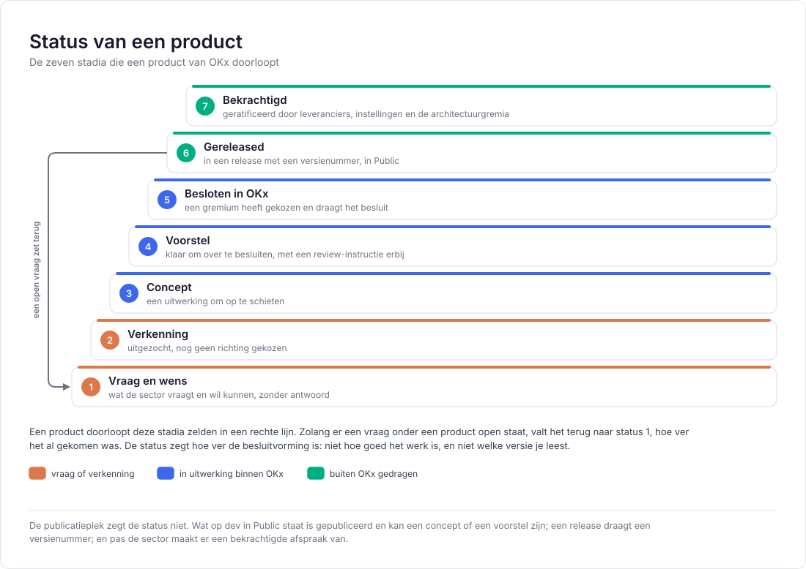
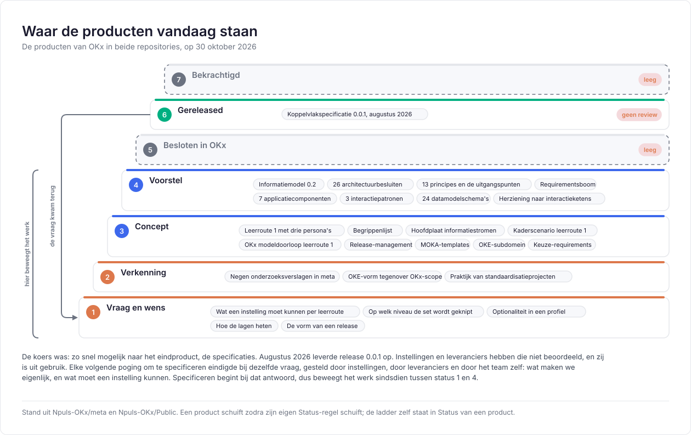

# Status

Deze repository draagt werk in alle stadia: een vraag die net is opgeschreven staat naast een uitwerking waar maanden in zit. Zonder aanduiding leest dat hetzelfde, en wordt een schets gelezen als een besluit.

Elk product van OKx draagt daarom een status: hoe ver de besluitvorming erover is. Dat is dezelfde afspraak die elk architectuurbesluit al kent met zijn `Status`-regel.

De ladder loopt zelden in een rechte lijn. Zolang er een vraag onder een product open staat, valt het terug naar status 1, hoe ver het al gekomen was.

## Stand vandaag

De koers was: zo snel mogelijk naar het eindproduct, de specificaties. Augustus 2026 leverde [release 0.0.1](https://github.com/Npuls-OKx/Public/releases) op in Public. Instellingen en leveranciers hebben die niet beoordeeld, en zij is uit gebruik.

Elke volgende poging om te specificeren eindigde bij dezelfde vraag, gesteld door instellingen, door leveranciers en door het team zelf: wat maken we eigenlijk, en wat moet een instelling kunnen. Specificeren begint bij dat antwoord. Sindsdien beweegt het werk tussen status 1 en 4.

Een lezer die dat weet, leest de rest anders. Een concept is een uitnodiging om mee te denken, en geen claim om tegenin te gaan.

| Status | Stand |
|---|---|
| 5, besloten in OKx | Leeg. De 26 besluiten in [Referentiemateriaal/adr](https://github.com/Npuls-OKx/Public/tree/dev/Referentiemateriaal/adr) staan op `Voorstel`. Zij leggen vast wat het team koos en waarom, zodat een keuze herleidbaar is; een gremium heeft ze nog niet gedragen |
| 7, bekrachtigd | Leeg. Er is nog geen set documentatie waarvan de sector heeft gezegd dat zij zich eraan houdt |

## Publicatieplek

De plek waar iets staat zegt niets over de status. Wat op `dev` in Public staat is gepubliceerd en blijft een concept of een voorstel.

| Plek | Wat die plek zegt |
|---|---|
| Een branch in meta | Werk in bewerking, met een pull request als het ter beoordeling ligt |
| `dev` in meta | De werkversie waar het team mee verder bouwt |
| `dev` in Public | Gepubliceerd voor de sector, op de status die het stuk zelf draagt |
| Een release met een versienummer | Status 6, met de datum en de versie erbij |

## Statusregel per soort

| Waar | Hoe de status zichtbaar is |
|---|---|
| Een document | Een regel bij de kop, of de statusregel in de leesroute |
| Een besluit | De `Status`-regel in het besluit zelf is leidend |
| Een beeld uit het informatiemodel | Het merk in het vak: een voorstel staat gestippeld met `toe te voegen aan het informatiemodel` erin, en valt daarmee op status 4 |
| Een aanname in een beeld | Gestippeld, zonder merk: een invulling van het voorbeeld, geen uitspraak over de werkelijkheid |
| Een plaat in de Npuls-vormtaal | Een vraagteken bij een regel die open staat, en de status in de voetregel |
| Een issue | Het label en de milestone zeggen waar het werk staat, de tekst zegt de status |

## Afbakening

Een status is geen versienummer. Een versie zegt welke uitgave je leest, een status hoe hard de inhoud is; een document kan versie 0.2 dragen en op status 3 staan. Het versiebeleid staat in [Release en versionering](OKx_Release-management-en-versionering.md).

Een status is ook geen oordeel over kwaliteit. Een verkenning op status 2 kan beter onderbouwd zijn dan een concept op status 3; de status zegt alleen hoe ver de besluitvorming is.

Relateert aan: #452.
