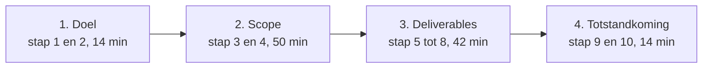
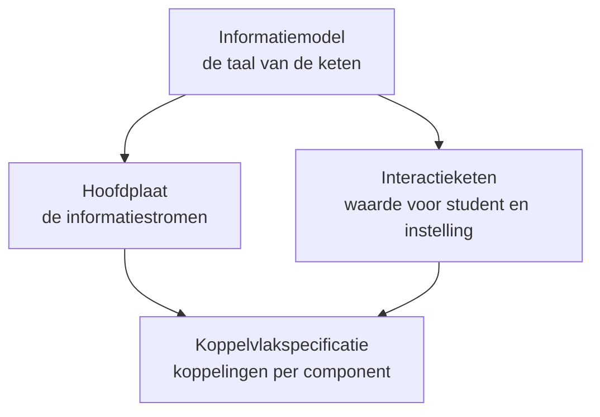
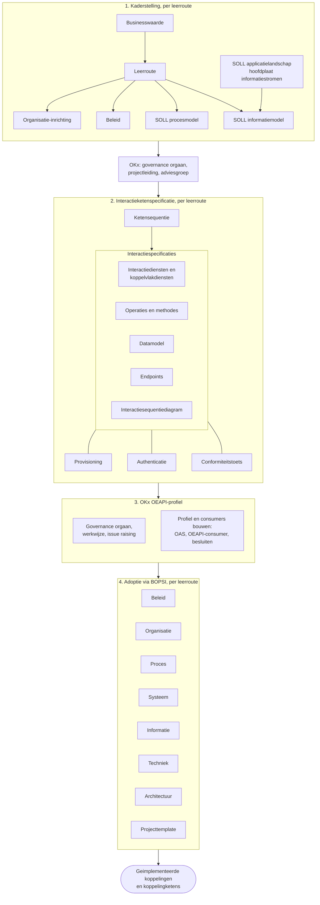
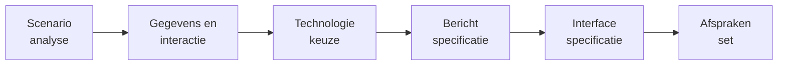

# Leesroute OKx

## 1. Inleiding

### 1.1 Context

Het werk van OKx staat verdeeld over twee repositories en ruim tweehonderd documenten. Deze route wijst een leesvolgorde aan: tien stappen, samen ongeveer twee uur, voor wie architectuur leest en OKx nog niet kent.

### 1.2 Doel

Na de route zijn vier vragen te beantwoorden.

Blijft een van de vier onbeantwoord, dan hoort dat als issue in deze repository.

### 1.3 Scope

In scope: de kaderstelling, de scope van OKx, de deliverables en de werkwijze waarmee die tot stand komen.

Het bouwen tegen een koppelvlak begint bij de [koppelvlakspecificaties in Public](https://github.com/Npuls-OKx/Public/blob/dev/Koppelvlakspecificaties/README.md), die daar hun eigen leesvolgorde dragen. De werkwijze voor een bijdrage staat in [`CONTRIBUTING.md`](../CONTRIBUTING.md), de werkwijze voor agents in [`AGENTS.md`](../AGENTS.md). Al het overige valt buiten deze route.

### 1.4 Leeswijzer

| Veld per stap | Betekenis |
|---|---|
| Beantwoordt | De vraag die het document oplost |
| Overslaan | Wat bij eerste lezing buiten de route blijft |
| Stand | Hoe hard het materiaal is, met de pull request die eraan werkt |
| Omvang | Woordtelling en leestijd bij honderdtachtig woorden per minuut |

Statuslabels en versienummers staan in de bron, niet in deze route.

## 2. Doel

### Stap 1. De twee repositories

[`README.md` in Npuls-OKx/Public](https://github.com/Npuls-OKx/Public/blob/dev/README.md)

| | |
|---|---|
| Beantwoordt | Welke repository draagt wat, en welke kopie van een document is leidend |
| Overslaan | Niets |
| Stand | De indeling staat in het document beschreven |
| Omvang | 343 woorden, 2 minuten |

De kaderstelling ontstaat in `Npuls-OKx/meta`. `Npuls-OKx/Public` draagt de releaseartefacten. Voor een uitspraak naar buiten geldt de versie in Public.

### Stap 2. De principes en de uitgangspunten

[`principes.md`](https://github.com/Npuls-OKx/Public/blob/dev/Referentiemateriaal/principes/principes.md) met de [uitgangspunten](https://github.com/Npuls-OKx/Public/blob/dev/Referentiemateriaal/principes/uitgangspunten.md)

| | |
|---|---|
| Beantwoordt | Welke richting onder alle uitwerkingen ligt, en welke standaardiseringsroute het project volgt |
| Overslaan | De toelichting per principe |
| Stand | Vastgelegd in Public. [Public PR 71](https://github.com/Npuls-OKx/Public/pull/71) voegt een principe toe dat eisen voor de techniekkeuze plaatst |
| Omvang | 2112 woorden, 12 minuten |

## 3. Scope

### Stap 3. De architectuurbesluiten

[`adr/README.md`](https://github.com/Npuls-OKx/Public/blob/dev/Referentiemateriaal/adr/README.md), met vier besluiten voluit:

| Besluit | Draagt |
|---|---|
| [0008 afbakening](https://github.com/Npuls-OKx/Public/blob/dev/Referentiemateriaal/adr/0008-scope-planning-eerst-intra-instelling.md) | Wat binnen bereik valt, en waarom federatie later komt |
| [0019 gelaagdheid](https://github.com/Npuls-OKx/Public/blob/dev/Referentiemateriaal/adr/0019-conceptuele-gelaagdheid-kwalificatie-specificatie-aanbod-rosa-koi.md) | De verhouding met ROSA en het Kernmodel Onderwijsinformatie |
| [0022 resultaatbegrippen](https://github.com/Npuls-OKx/Public/blob/dev/Referentiemateriaal/adr/0022-resultaatbegrippen-conform-rosa-koi.md) | Hetzelfde, voor de resultaatkant van de keten |
| [0026 leeruitkomst](https://github.com/Npuls-OKx/Public/blob/dev/Referentiemateriaal/adr/0026-leeruitkomst-als-verbindende-sleutel.md) | Het scharnier van het informatiemodel |

| | |
|---|---|
| Beantwoordt | Welke keuzes vastliggen, met welke onderbouwing |
| Overslaan | De overige besluiten, tot er een op een eigen vraag drukt |
| Stand | Alle besluiten dragen de status voorstel; de `Status`-regel in het besluit is leidend. [Public PR 71](https://github.com/Npuls-OKx/Public/pull/71) en [72](https://github.com/Npuls-OKx/Public/pull/72) voegen besluiten toe |
| Omvang | 2920 woorden, 16 minuten |

### Stap 4. Het kaderscenario van de reguliere leerroute

[`leerroute-1-regulier.md`](https://github.com/Npuls-OKx/Public/blob/dev/Referentiemateriaal/kaderscenario's/leerroute-1-regulier.md), vier secties: de opening tot en met de leeswijzer, *De procesbeleving achter 'regulier' onderwijs van een Instelling*, *Betrokken informatie bij proces*, *Procesfasen, interacties op de plaat en informatie*, en *Componenten en hun doel*.

| | |
|---|---|
| Beantwoordt | Wat er in de keten gebeurt, welke informatie waar ontstaat, en welke componenten welke rol dragen |
| Overslaan | De studentreis, de keuzedelen in detail, de gegevensoverzichten, de anti-patronen, en het concept-informatiemodel dat in stap 5 vastgelegd terugkomt |
| Stand | Kaderstellend voor de reguliere leerroute; de andere leerroutes volgen als verschil daarop. [meta PR 144](https://github.com/Npuls-OKx/meta/pull/144) herstructureert de leerroute-uitwerking |
| Omvang | 6030 van 15679 woorden, 34 minuten. Voluit 87 minuten |

## 4. Deliverables

OKx levert een set specificaties van de koppelingen tussen de componenten in de onderwijsketen. Die set dient als functioneel ontwerp voor een implementatie, bij voorkeur als [OEAPI-profiel](https://oeapi.eu/v6.0/#/technical/consumers-and-profiles/profiling-guidelines). Valt een eis buiten de profielvorm, dan komt een andere generieke standaard in beeld, zoals een eigen REST OpenAPI-specificatie of GraphQL. Het uitgangspunt is OEAPI tenzij.

[OKE](https://www.edustandaard.nl/app/uploads/2026/06/OKE-MBO-toetsafname-specs-v1.0.1_20260527definitief.pdf) specificeert de toetsafname in het mbo op een scherp afgebakend procesgebied met vastgelegde documentatie: examinering en verantwoording. OKx draagt een bredere scope met meer belanghebbenden, waardoor de OKE-vorm hier als vertrekpunt dient en de uiteindelijke vorm een eigen uitwerking vraagt. Welke eigenschappen van die vorm overdragen, wordt onderzocht in [#422](https://github.com/Npuls-OKx/meta/issues/422).

De vier deliverables hangen aan elkaar: het model levert de taal, de plaat de stromen, de specificatie het contract, en de interactieketen verbindt de waarde met dat contract.

Drie lagen dragen die samenhang. Een **informatiestroom** is de beweging van gegevens tussen twee componenten. Een **koppeling** is de gestandaardiseerde realisatie daarvan. Een **koppelvlak** is de verzameling koppelingen van precies een component.

### Productopdeling, concept

De vier deliverables hierboven zijn de producten die vandaag bestaan. De opdeling van de volledige set staat als concept in [#396](https://github.com/Npuls-OKx/meta/issues/396), met de instellingsspecificatie als nieuw product tussen de leerroutes en de koppelvlakspecificatie.

Per laag een dragende partij:

| Laag | Draagt het | Toetst het |
|---|---|---|
| Kaderstelling | Het programma Npuls met de instelling, vanuit de instellingsreis van vandaag | Adviesgroep |
| Interactieketenspecificatie | De solution architecten van OKx | Kerngroep techniek |
| OEAPI-profiel en consumers | OKx met de leveranciers | Kerngroep techniek en de werkgroep van de standaard |
| Adoptie | BOPSI, met de instelling | Governance orgaan |

De instellingsspecificatie draagt per leerroute een businessarchitectuur: wat een instelling moet kunnen om die leerroute te voeren. Die kennis is vandaag impliciet, deels uit MORA, en dat maakt het vullen van de koppelvlakspecificatie een vraag zonder vastgelegd antwoord. De naam, de inhoud en de dragende rol per product zijn concept.

De vorm van de set rijpt in de specificatiefase. Deze vragen staan open, elk met de plek waar die wordt uitgewerkt.

| Vraag | Wordt uitgewerkt in |
|---|---|
| Welke eenheden leveren waarde voor student, instelling en leverancier | De proefopstellingen die user stories en businesswaarde namens instellingen ophalen |
| Welke producten de set draagt, in welke vorm, en waarvan die afhangen | [#421](https://github.com/Npuls-OKx/meta/issues/421) projectstartarchitectuur, met [#396](https://github.com/Npuls-OKx/meta/issues/396) productopdeling eronder |
| Welke eigenschappen van de OKE-vorm overdragen | [#422](https://github.com/Npuls-OKx/meta/issues/422) |
| Welke partij maakt welk architectuurproduct in de sectorketen | [#300](https://github.com/Npuls-OKx/meta/pull/300) met [#262](https://github.com/Npuls-OKx/meta/issues/262), zeven lagen en achtenvijftig producten uit een bron |
| Wat OKx versioneert, en wat als OEAPI-profiel naar buiten gaat | [#342](https://github.com/Npuls-OKx/meta/issues/342) specificatielagen |
| Welke koppelingen lopen waar, en welke informatie ontstaat waar en beweegt hoe | [#259](https://github.com/Npuls-OKx/meta/issues/259) speelveld en ecosysteem |
| Waar het informatiemodel OEAPI v6 raakt | [#218](https://github.com/Npuls-OKx/meta/issues/218) |

De vraag die boven alle andere staat: wat de sector precies genoeg geformuleerd wil hebben om het te adopteren. Daarop richten de proefopstellingen zich.

### Stap 5. Het informatiemodel

[`informatiemodel.md`](https://github.com/Npuls-OKx/Public/blob/dev/Informatie-en-gegevensmodellen/informatiemodel.md) met [`begrippen.md`](https://github.com/Npuls-OKx/Public/blob/dev/Informatie-en-gegevensmodellen/begrippen.md) als naslag

| | |
|---|---|
| Beantwoordt | Welke objecttypen de keten kent, hoe die samenhangen, en welke begrippenfamilies haar indelen |
| Overslaan | De ontwerpkeuzes met de status voorstel |
| Stand | Laag 1 en 2 vastgelegd in Public. [Public PR 131](https://github.com/Npuls-OKx/Public/pull/131) brengt de modelronde van oktober, met de review-instructie daarin; [meta PR 391](https://github.com/Npuls-OKx/meta/pull/391) raakt het kwalificatiekader, [410](https://github.com/Npuls-OKx/meta/pull/410) de resultaatkant |
| Omvang | 2741 woorden, 15 minuten |

### Stap 6. De hoofdplaat informatiestromen

De hoogste versiemap onder [`architecture/model/informatiestromen hoofdplaat OKx/`](../architecture/model/)

| | |
|---|---|
| Beantwoordt | Welke stromen tussen welke componenten lopen, en welke nog een beschrijving vragen |
| Overslaan | De eerdere versiemappen, die de historie dragen |
| Stand | Werkbeeld: elke stroom is een kandidaat voor een koppelingspecificatie. [meta PR 412](https://github.com/Npuls-OKx/meta/pull/412) en [Public PR 133](https://github.com/Npuls-OKx/Public/pull/133) werken de plaat bij |
| Omvang | Een plaat met leeswijzer, 5 minuten |

Het ArchiMate-model achter de plaat opent in Archi; de platen in stap 5, 6 en 8 dragen de inhoud.

### Stap 7. De koppelvlakspecificatie

[`Koppelvlakspecificaties/README.md`](https://github.com/Npuls-OKx/Public/blob/dev/Koppelvlakspecificaties/README.md) met [`uitgangspunten.md`](https://github.com/Npuls-OKx/Public/blob/dev/Koppelvlakspecificaties/uitgangspunten.md)

| | |
|---|---|
| Beantwoordt | Wat een afgeronde beschrijving bevat, en hoe koppeling en koppelvlak zich verhouden |
| Overslaan | De uitgangspunten buiten de eigen vraag; de README wijst de leesvolgorde |
| Stand | Het eerste pakket is uitgebracht en wordt herzien, zie stap 8. [Public PR 100](https://github.com/Npuls-OKx/Public/pull/100) legt een laag applicatiediensten tussen component en endpoint |
| Omvang | 1998 woorden, 11 minuten |

Wie verder wil, opent een applicatiecomponent met zijn interactiepatroon en een datamodelschema.

### Stap 8. De interactieketens

[meta PR 373](https://github.com/Npuls-OKx/meta/pull/373) onderwijsaanbod, [387](https://github.com/Npuls-OKx/meta/pull/387) student-instroom, [364](https://github.com/Npuls-OKx/meta/pull/364) keuzedelen, [377](https://github.com/Npuls-OKx/meta/pull/377) OpenAPI per component

| | |
|---|---|
| Beantwoordt | Hoe een keten loopt van de waarde voor student en instelling tot een machineleesbaar contract |
| Overslaan | De stroomdocumenten en de OpenAPI-documenten; lees per pull request de review-instructie en de eerste plaat |
| Stand | Nog op een branch. Dit is de herziening van de koppelvlakspecificaties: de keten begint bij de waarde en trekt die door naar de koppelingen. [Public PR 100](https://github.com/Npuls-OKx/Public/pull/100) legt de dienstlaag eronder. De twee vormen komen nog samen |
| Omvang | 1975 woorden voor de keten onderwijsaanbod, 11 minuten |

## 5. Totstandkoming deliverables

De route van een vraag naar een vastgelegde afspraak volgt AMIGO, met de product-flow per deliverable eromheen.

### Stap 9. De requirementsboom

[`requirementsboom/README.md`](https://github.com/Npuls-OKx/Public/blob/dev/Referentiemateriaal/requirementsboom/README.md) met [`opdracht.md`](https://github.com/Npuls-OKx/Public/blob/dev/Referentiemateriaal/requirementsboom/opdracht.md) en [`epics.md`](https://github.com/Npuls-OKx/Public/blob/dev/Referentiemateriaal/requirementsboom/epics.md)

| | |
|---|---|
| Beantwoordt | Hoe een stuk werk aan de opdracht hangt: opdracht, epic, feature, story |
| Overslaan | `features.md` en `stories.md`; de bovenste lagen tonen de vorm |
| Stand | Vroeg concept. De boom demonstreert de vorm van een uiteindelijke uitwerking van de verzamelde requirements-analyse. De werkelijke breakdown ontstaat in de proefopstellingen die Niels van Duin uitvoert, en loopt voorlopig buiten de boom om |
| Omvang | 1440 woorden, 8 minuten |

Wat er gebouwd wordt staat in de milestones en de pull requests.

### Stap 10. Release en beheer

[`Release-management-algemeen.md`](https://github.com/Npuls-OKx/Public/blob/dev/Algemeen/release-management/Release-management-algemeen.md), met de milestones van [meta](https://github.com/Npuls-OKx/meta/milestones) en [Public](https://github.com/Npuls-OKx/Public/milestones) en het [wijzigingenoverzicht](../CHANGELOG.md)

| | |
|---|---|
| Beantwoordt | Wie het resultaat draagt, hoe een versie tot stand komt, en wat vandaag openstaat |
| Overslaan | Niets |
| Stand | Elk pakket in Public draagt een eigen versielijn met een manifest. [Public PR 82](https://github.com/Npuls-OKx/Public/pull/82) brengt de volgende momentopname |
| Omvang | 1109 woorden en twee milestonelijsten, 6 minuten |

Zolang een pakket zijn eerste stabiele versie nog bereikt, kan elk onderdeel eraan wijzigen.
