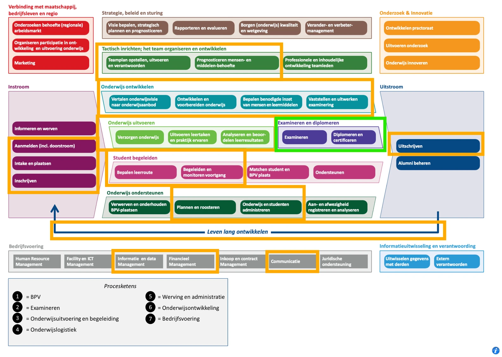
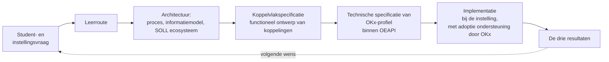
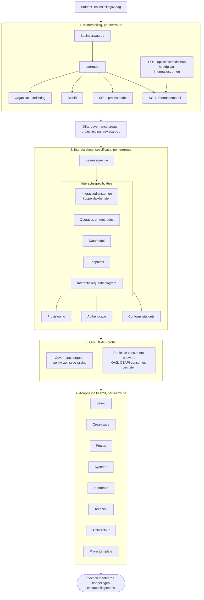
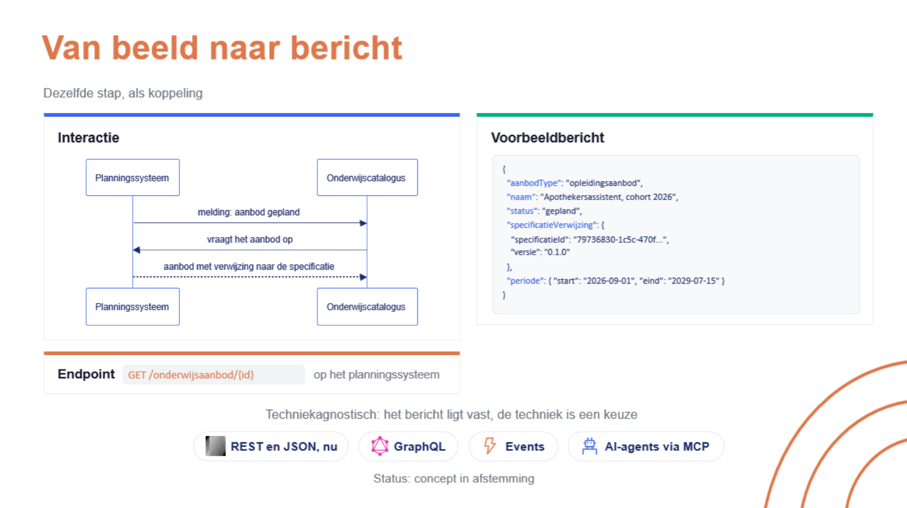

# Leesroute OKx

| Deel | Kern | Verdieping |
|---|---|---|
| [1 Context](#deel-1-context) | 5 min | optioneel, 12 min |
| [2 Historisch overzicht](#deel-2-historisch-overzicht) | | optioneel, 10 min |
| [3 Scope](#deel-3-scope) | 10 min | optioneel, 50 min |
| [4 Deliverables](#deel-4-deliverables) | 18 min | optioneel, 65 min |
| [5 Architectuurbesluiten](#deel-5-architectuurbesluiten) | 6 min | optioneel, 23 min |
| [6 Release en beheer](#deel-6-release-en-beheer) | 4 min | optioneel, 9 min |

Kern: 43 minuten. Alles: ongeveer drie uur.

Leestijd is de woordtelling gedeeld door honderdtwintig woorden per minuut, het tempo waarop architectuurmateriaal leest dat een lezer moet kunnen navertellen. Per stap staat de status van het materiaal met de lopende pull request erbij; de route schrijft geen statuswaarde over.

## Deel 1, context

OKx legt gestandaardiseerde koppelingen vast voor de onderwijslogistiek, zodat een student binnen en later buiten de eigen instelling onderwijs kan kiezen en volgen terwijl de administratie meebeweegt. Het project valt onder de transformatiehub Wendbaar georganiseerd onderwijs van Npuls, in samenwerking met Digitale sectorvoorzieningen.

De kaderstelling ontstaat in `Npuls-OKx/meta`; `Npuls-OKx/Public` draagt de releaseartefacten. Bestaat een document in beide, dan geldt voor een uitspraak naar buiten de versie in Public.

Kern: de [managementsamenvatting](OKx_Context.md#managementsamenvatting), 5 minuten.

### Verdieping: het contextdocument

[OKx in context](OKx_Context.md)

| | |
|---|---|
| Beantwoordt | Wat de opdracht is, welke resultaten die draagt, met welke initiatieven OKx raakvlakken heeft, wie wat beslist, en welke uitdagingen eronder liggen |
| Overslaan | Niets bij eerste lezing; wie haast heeft leest de managementsamenvatting |
| Status | Samengesteld uit het projectplan en de platen van het programma. Elke sectie draagt haar herkomst, zodat een uitspraak uit het plan te onderscheiden is van een afleiding. Het plan zelf staat nog niet in deze repository, zie [#449](https://github.com/Npuls-OKx/meta/issues/449) |
| Omvang | 1388 woorden, 12 minuten |

## Deel 2, historisch overzicht

### Verdieping: het historisch overzicht

[Hoe OKx hier kwam](OKx_Historie.md)

| | |
|---|---|
| Beantwoordt | Welke keerpunten het project doorliep sinds november 2024, en waarom de vorm van de oplevering nog beweegt |
| Overslaan | De bronnen achter elk keerpunt; die zijn er voor wie wil doorklikken |
| Status | De periode voor maart 2026 steunt op het projectplan en het geheugen van het team |
| Omvang | Een pagina met veertien keerpunten, 10 minuten |

## Deel 3, scope

OKE begon op de examenketen. OKx acteert op de processen daaromheen.

*Hoofdprocesmodel [MORA](https://mora.mbodigitaal.nl/index.php/Hoofdpagina). Goud omlijnd: de processen waarop OKx acteert. Groen omlijnd: waar OKE begon.*

De integratie van die ketens over de studentreizen heen heet in het kaderscenario de **instellingsreis**. Dat is waar de koppelingen van OKx ontstaan.

De grens die daarbij hoort:

| Onderdeel | Hoort bij |
|---|---|
| De applicatie | De leverancier |
| Les en didactiek | De instelling, vastgelegd in de specificatie |
| De landelijke voorzieningen | Hun eigen pijler |

Welke leerroutes eerst aan bod komen, staat in de [basisuitgangspunten](OKx_Context.md#basisuitgangspunten): prioriteit bij 1, 2, 3, 4 en 7. De [negen leerroutes van Npuls](../architecture/docs/specificatie/leerroute-uitwerking/img/README.md) staan als tekening bij elkaar, met per route de keten van persona, uitwerking, scenario's en voorbeeldregels.

### Verdieping: het kaderscenario

[`leerroute-1-regulier.md`](https://github.com/Npuls-OKx/Public/blob/dev/Referentiemateriaal/kaderscenario's/leerroute-1-regulier.md), vier secties: de opening tot en met de leeswijzer, *De procesbeleving achter 'regulier' onderwijs van een Instelling*, *Betrokken informatie bij proces*, *Procesfasen, interacties op de plaat en informatie*, en *Componenten en hun doel*.

| | |
|---|---|
| Beantwoordt | Wat er in de keten gebeurt, welke informatie waar ontstaat, en welke componenten welke rol dragen |
| Overslaan | De studentreis, de keuzedelen in detail, de gegevensoverzichten, de anti-patronen, en het concept-informatiemodel dat in deel 4 vastgelegd terugkomt |
| Status | Kaderstellend voor de reguliere leerroute; de andere leerroutes volgen als verschil daarop. [meta PR 144](https://github.com/Npuls-OKx/meta/pull/144) herstructureert de uitwerking |
| Omvang | 6030 van 15679 woorden, 50 minuten. Voluit ruim twee uur |

## Deel 4, deliverables

OKx levert een set specificaties van de koppelingen tussen de componenten in de onderwijsketen. Die set dient als functioneel ontwerp voor een implementatie, bij voorkeur als [OEAPI-profiel](https://oeapi.eu/v6.0/#/technical/consumers-and-profiles/profiling-guidelines). Valt een eis buiten de profielvorm, dan komt een andere generieke standaard in beeld. Het uitgangspunt is OEAPI tenzij.

Die route volgt de [AMIGO-aanpak](https://www.edustandaard.nl/amigo/aanpak/) van Edustandaard:

| AMIGO-stap | In de route naar het eindproduct |
|---|---|
| Scenario-analyse | Userstories, op de leerroute en het kaderscenario |
| Gegevensanalyse | Bouwblokken, begrippen en het informatiemodel |
| Interactieanalyse | Informatiestromen tussen applicatiecomponenten |
| Technologiekeuze | OEAPI tenzij; de keuze ligt bij OKx, in afstemming met de sector via de kerngroep techniek en de adviesgroep |
| Berichtspecificatie | Datamodelschema's, payloads en berichtstromen |
| Interfacespecificatie | Endpoints, operaties, antwoorden en voorbeelden |
| Afsprakenset | De koppelvlakspecificatie als geheel, met authenticatie en het inrichten van toegang erbij |

Drie lagen dragen de uitwerking. Een **informatiestroom** is de beweging van gegevens tussen twee componenten. Een **koppeling** is de gestandaardiseerde realisatie daarvan. Een **koppelvlak** is de verzameling koppelingen van precies een component.

Elke specificatie begint bij een wens in de student- en instellingsreis en sluit de cirkel bij de drie resultaten.

### Productopdeling, concept

De opdeling van de volledige set staat als concept in [#396](https://github.com/Npuls-OKx/meta/issues/396), met de instellingsspecificatie als nieuw product tussen de leerroutes en de koppelvlakspecificatie.

Per laag een dragende partij:

| Laag | Draagt het | Toetst het |
|---|---|---|
| Kaderstelling | Het programma met de instelling, vanuit de instellingsreis van vandaag | Adviesgroep |
| Interactieketenspecificatie | De solution architecten van OKx | Kerngroep techniek |
| OEAPI-profiel en consumers | OKx met de leveranciers | Kerngroep techniek en de werkgroep van de standaard |
| Adoptie | BOPSI, met de instelling | Governance orgaan |

### Status van de route

De opdeling hierboven is een concept, en de route eromheen wordt aangescherpt. Wat er ligt, wat nu bepaald wordt en waar het naartoe gaat staat in [de status van het werk](OKx_Context.md#status-van-het-werk). De laag die het langst openstaat is die van de instelling: wat een instelling doet, in welke volgorde, en welke informatie daarbij beweegt. Zolang dat beeld ontbreekt laat de set koppelingen zich niet afbakenen, en laat de vorm waarin zij uitkomt zich niet kiezen. Het vastzetten van de specificatie- en releasestructuur staat daarom stil tot dat beeld er is ([#424](https://github.com/Npuls-OKx/meta/issues/424)).

Het werk loopt nu via de reis van een instelling, per leerroute, in drie lagen.

| Laag | Wat het vastlegt | Voor leerroute 1 |
|---|---|---|
| Persona | De lerende, en wat zijn situatie van de instelling vraagt | [`persona_jochem.md`](../architecture/docs/specificatie/leerroute-uitwerking/doc/persona_jochem.md) |
| Leerroutedocument | Wat de instelling doet per fase, met de componenten en objecttypen die daarbij oplichten | [kaderscenario leerroute 1](https://github.com/Npuls-OKx/Public/blob/dev/Referentiemateriaal/kaderscenario's/leerroute-1-regulier.md) |
| Informatiemodel-voorbeeldregels | Per processtap welke objecten ontstaan, veranderen en stromen, met de bron erbij | [`voorbeeld-leerroute-1-jochem.md`](../architecture/model/informatiemodel/voorbeeld-leerroute-1-jochem.md) |

Leerroute 1 draagt die drie lagen. Leerroute 2 en 3 staan in de milestone [Instellingsreizen per leerroute](https://github.com/Npuls-OKx/meta/milestone/24). De maat: een instelling herkent zich voor ongeveer tachtig procent in zo'n beschrijving, en de rest is lokale variant die als variant wordt vastgelegd.

Daarnaast loopt een tweede lijn: de capabilities van de voorziening, oftewel wat een functiegebied moet kunnen, los van het product waarin dat landt. De informatiemodel-voorbeelden verbinden die twee lijnen, want daar staat per stap welke objecten bewegen. Het onderzoek naar die verhouding staat in [#422](https://github.com/Npuls-OKx/meta/issues/422).

### Verdieping: het informatiemodel

[`informatiemodel.md`](https://github.com/Npuls-OKx/Public/blob/dev/Informatie-en-gegevensmodellen/informatiemodel.md) met [`begrippen.md`](https://github.com/Npuls-OKx/Public/blob/dev/Informatie-en-gegevensmodellen/begrippen.md) als naslag

| | |
|---|---|
| Beantwoordt | Welke objecttypen de keten kent, hoe die samenhangen, en welke begrippenfamilies haar indelen |
| Overslaan | De ontwerpkeuzes met de status voorstel |
| Status | Laag 1 en 2 vastgelegd in Public, met de modelronde van oktober erin ([Public PR 131](https://github.com/Npuls-OKx/Public/pull/131)). Lopend: [meta PR 391](https://github.com/Npuls-OKx/meta/pull/391) raakt het kwalificatiekader, [410](https://github.com/Npuls-OKx/meta/pull/410) de resultaatkant |
| Omvang | 2741 woorden, 23 minuten |

### Verdieping: de hoofdplaat informatiestromen

De hoogste versiemap onder [`architecture/model/informatiestromen hoofdplaat OKx/`](../architecture/model/)

| | |
|---|---|
| Beantwoordt | Welke stromen tussen welke componenten lopen, en welke nog een beschrijving vragen |
| Overslaan | De eerdere versiemappen, die de historie dragen |
| Status | Werkbeeld: elke stroom is een kandidaat voor een koppelingspecificatie. [meta PR 412](https://github.com/Npuls-OKx/meta/pull/412) en [Public PR 133](https://github.com/Npuls-OKx/Public/pull/133) werken de plaat bij |
| Omvang | Een plaat met leeswijzer, 10 minuten |

Het ArchiMate-model achter de plaat opent in Archi; de platen in dit deel dragen de inhoud.

### Verdieping: de koppelvlakspecificatie

[`Koppelvlakspecificaties/README.md`](https://github.com/Npuls-OKx/Public/blob/dev/Koppelvlakspecificaties/README.md) met [`uitgangspunten.md`](https://github.com/Npuls-OKx/Public/blob/dev/Koppelvlakspecificaties/uitgangspunten.md)

| | |
|---|---|
| Beantwoordt | Wat een afgeronde beschrijving bevat, en hoe koppeling en koppelvlak zich verhouden |
| Overslaan | De uitgangspunten buiten de eigen vraag; de README wijst de leesvolgorde |
| Status | Het eerste pakket is uitgebracht en wordt herzien naar interactieketens: [meta PR 373](https://github.com/Npuls-OKx/meta/pull/373) onderwijsaanbod en [387](https://github.com/Npuls-OKx/meta/pull/387) student-instroom, zie de interactieketens hieronder. [Public PR 100](https://github.com/Npuls-OKx/Public/pull/100) legt een laag applicatiediensten tussen component en endpoint |
| Omvang | 1998 woorden, 17 minuten |

Wie verder wil, opent een applicatiecomponent met zijn interactiepatroon en een datamodelschema.

### Verdieping: de interactieketens

[meta PR 373](https://github.com/Npuls-OKx/meta/pull/373) onderwijsaanbod, [387](https://github.com/Npuls-OKx/meta/pull/387) student-instroom, [364](https://github.com/Npuls-OKx/meta/pull/364) keuzedelen, [377](https://github.com/Npuls-OKx/meta/pull/377) OpenAPI per component

| | |
|---|---|
| Beantwoordt | Hoe een keten loopt van de waarde voor student en instelling tot een machineleesbaar contract |
| Overslaan | De stroomdocumenten en de OpenAPI-documenten; lees per pull request de review-instructie en de eerste plaat |
| Status | Nog op een branch. Dit is de herziening van de koppelvlakspecificaties: de keten begint bij de waarde en trekt die door naar de koppelingen. [Public PR 100](https://github.com/Npuls-OKx/Public/pull/100) legt de dienstlaag eronder. De twee vormen komen nog samen |
| Omvang | 1975 woorden voor de keten onderwijsaanbod, 17 minuten |

*Wat een specificatie uiteindelijk oplevert: de interactie, het bericht en het endpoint. Het bericht ligt vast, de techniek is een keuze.*

## Deel 5, architectuurbesluiten

| Vraag | Besluit | Laag |
|---|---|---|
| Waar ligt de grens | [0008](https://github.com/Npuls-OKx/Public/blob/dev/Referentiemateriaal/adr/0008-scope-planning-eerst-intra-instelling.md) eerst intra-instelling, federatie gefaseerd | kern |
| Wat is het ordenend principe | [0026](https://github.com/Npuls-OKx/Public/blob/dev/Referentiemateriaal/adr/0026-leeruitkomst-als-verbindende-sleutel.md) de leeruitkomst als verbindende sleutel | kern |
| Hoe verhoudt OKx zich tot de sectorarchitectuur | [0019](https://github.com/Npuls-OKx/Public/blob/dev/Referentiemateriaal/adr/0019-conceptuele-gelaagdheid-kwalificatie-specificatie-aanbod-rosa-koi.md) gelaagdheid en [0022](https://github.com/Npuls-OKx/Public/blob/dev/Referentiemateriaal/adr/0022-resultaatbegrippen-conform-rosa-koi.md) resultaatbegrippen | verdieping |
| Welke verdieping vraagt OKx in MORA | [0005](https://github.com/Npuls-OKx/Public/blob/dev/Referentiemateriaal/adr/0005-student-keuze-systeem-zelfstandige-referentiecomponent.md) het studentkeuzesysteem als zelfstandige referentiecomponent | verdieping |
| Welke taal dragen de producten | [0021](https://github.com/Npuls-OKx/Public/blob/dev/Referentiemateriaal/adr/0021-koppeling-versus-koppelvlak-terminologie.md) koppeling tegenover koppelvlak | verdieping |

### Verdieping: de overige besluiten

[`adr/README.md`](https://github.com/Npuls-OKx/Public/blob/dev/Referentiemateriaal/adr/README.md) met 0019, 0022, 0005 en 0021

| | |
|---|---|
| Beantwoordt | Hoe OKx zich tot ROSA en het Kernmodel Onderwijsinformatie verhoudt, welke verdieping het in MORA vraagt, en welke taal de producten dragen |
| Overslaan | De overige besluiten, tot er een op een eigen vraag drukt |
| Status | De `Status`-regel in elk besluit is leidend; een besluit kan ook vervangen zijn. Het onderscheid uit 0021 is in beweging: het kan opgaan in de interactieketen en de interactiespecificatie |
| Omvang | 2731 woorden, 23 minuten |

Verder lezen: 0003 en 0004 onder de leeruitkomst, 0009 en 0014 voor de rolverdeling tussen studentkeuzesysteem en studentvolgsysteem, en 0018 voor de messaging-patronen.

## Deel 6, release en beheer

Elk pakket in Public draagt een eigen versielijn met een manifest. Tot een pakket zijn eerste stabiele versie bereikt, kan elk onderdeel eraan wijzigen.

Wie iets wil toevoegen of corrigeren, opent een issue of een pull request; de werkwijze staat in [`CONTRIBUTING.md`](../CONTRIBUTING.md).

### Verdieping: release-management

[`Release-management-algemeen.md`](https://github.com/Npuls-OKx/Public/blob/dev/Algemeen/release-management/Release-management-algemeen.md), met de milestones van [meta](https://github.com/Npuls-OKx/meta/milestones) en [Public](https://github.com/Npuls-OKx/Public/milestones) en het [wijzigingenoverzicht](../CHANGELOG.md)

| | |
|---|---|
| Beantwoordt | Wie het resultaat draagt, hoe een versie tot stand komt, en wat vandaag openstaat |
| Overslaan | Niets |
| Status | Elk pakket in Public draagt een eigen versielijn met een manifest. [Public PR 82](https://github.com/Npuls-OKx/Public/pull/82) brengt de volgende momentopname |
| Omvang | 1109 woorden en twee milestonelijsten, 9 minuten |
