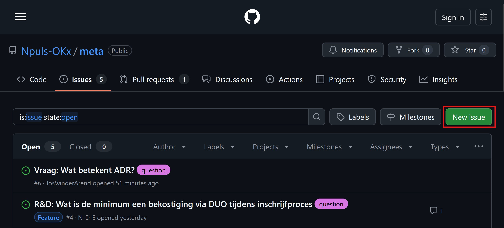
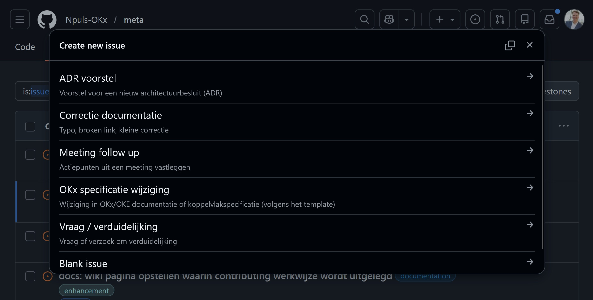
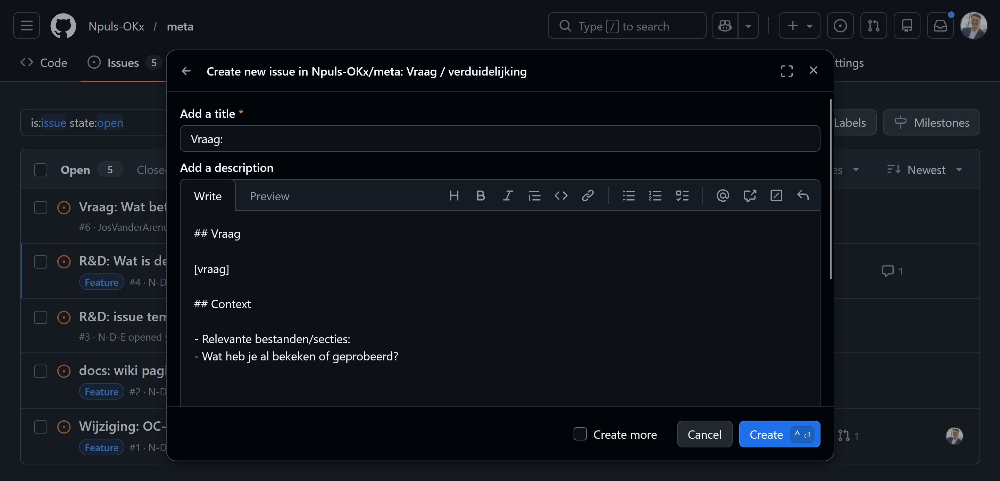
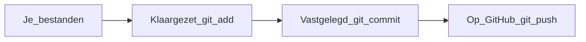

# Bijdragen aan OKx-meta

Deze handleiding gaat over de handeling: welke knop, welk commando, en wat het betekent. De afspraken staan in [`CONTRIBUTING.md`](../CONTRIBUTING.md): wie mag wat mergen, welke branch het vertrekpunt is, en welk sluitwoord een pull request draagt. Waar OKx inhoudelijk over gaat staat op de [landingspagina](../README.md) en in de [leesroute](leesroute.md).

De handleiding staat in de repository en niet op een wiki, zodat zij mee versioneert en meeverhuist. Neem ook [`privacy-meetings-en-transcriptie.md`](privacy-meetings-en-transcriptie.md) door wanneer je deelneemt aan OKx-meetings waarvan de inhoud hier kan terugkomen.

De route hieronder loopt van een vraag tot een pull request. Alleen een issue aanmaken is al een bijdrage; de rest hoeft pas wanneer je zelf tekst wilt aanleveren.

## Woordenlijst

| Term | Betekenis |
|---|---|
| Repository (repo) | De map met alle bestanden en de geschiedenis van alle wijzigingen |
| Git | Het programma dat die geschiedenis bijhoudt, lokaal op je computer |
| GitHub | De website waar de repository staat, met issues, pull requests en review |
| Branch | Een eigen lijn naast `dev`, waarin je kunt werken zonder iets te raken |
| Commit | Een opgeslagen bundel wijzigingen met een korte boodschap erbij |
| Pull request (PR) | Het verzoek om jouw branch samen te voegen, met review erop |
| Issue | Een ticket met een nummer (`#12`): een vraag, een fout of een voorstel |
| Milestone | De grotere klus waar een issue onder hangt, herleidbaar naar de requirementsboom |
| Review | Het meelezen door een ander voordat werk wordt samengevoegd |
| Agent | De AI-assistent die in stappen met de repository werkt, onder jouw regie |

## Een issue aanmaken

Lees je dit op GitHub, dan zit je al in de webinterface: bovenaan staan de tabbladen `Code`, `Issues` en `Pull requests`.

1. Open het tabblad `Issues`.
2. Klik op `New issue`. Zonder account vraagt GitHub je eerst in te loggen.



GitHub opent dan een keuzescherm. In deze repository staat een sjabloon, `OKx issue`, en daarnaast kun je een leeg issue openen. Het keuzescherm toont ook een contactlink voor wat beter per e-mail gaat.



Het sjabloon draagt zeven koppen, elk met een regel die zegt wanneer die kop vervalt: aanleiding, inbreng, observaties, story, acceptatiecriteria, testgevallen en vragen. Voor een tikfout of een dode link houd je de aanleiding, de observatie en een acceptatiecriterium over; de rest laat je weg. Hoe meer detail in wat je wel invult, hoe beter.



De drie beelden zijn gemaakt op 20 augustus 2026. Het keuzescherm bevat sinds november 2026 een sjabloon in plaats van zes.

Een issue is de plek voor inhoud, richting en afstemming, en voor wat je alleen wilt signaleren. Discussions zijn breder; een issue is te koppelen aan een pull request en aan een milestone.

## De eerste wijziging

Vanaf hier wijzig je zelf bestanden. Je breekt daarmee niets: jouw werk komt op een eigen branch en wordt pas onderdeel van de repository nadat het team het heeft samengevoegd.

| Route | Wat je doet |
|---|---|
| In de browser | Open een bestand op GitHub, klik op het potlood, wijzig de tekst en kies `Create a new branch for this commit`. Handig voor een kleine wijziging |
| Met Git op je computer | Installeer Git via [git-scm.com](https://git-scm.com), kloon de repository en werk in een editor. Handig voor langere teksten en meerdere bestanden |

Klonen gaat met de HTTPS-URL achter de groene knop `Code`:

```bash
git clone <HTTPS-URL-van-de-repository>.git
cd OKx-meta
```

Daarna haal je `dev` op en begin je een eigen branch:

```bash
git checkout dev
git pull origin dev
git checkout -b 123-korte-omschrijving
```

Wijzig de bestanden in je editor en kijk met `git status` en `git diff` wat er veranderd is. Opslaan en versturen gaat in drie stappen:

```bash
git add .
git commit -m "Korte duidelijke boodschap"
git push -u origin 123-korte-omschrijving
```



`git add` zegt welke wijzigingen meegaan, `git commit` legt ze vast op je eigen computer, en `git push` stuurt ze naar GitHub. Pushen alleen maakt het nog niet officieel; daarvoor is een pull request nodig.

## Branches

Een branch is een naam voor een lijn van commits naast andere lijnen. `dev` is de lijn waar het werk samenkomt en het vertrekpunt van elke nieuwe branch. Een branch per issue, met het issuenummer voorop in de naam.

De branch `main` bestaat sinds 5 oktober 2026 niet meer en is bewaard als de tag `archief/main`. Kom je een beschrijving tegen die nog een pull request naar `main` noemt, dan is die verouderd. De volledige branchstrategie staat in [`CONTRIBUTING.md`](../CONTRIBUTING.md).

## De pull request

Een pull request is een verzoek aan het team: bekijk mijn branch, en voeg hem samen wanneer hij klopt. Tot die merge blijft jouw werk een voorstel.

1. Na een push toont GitHub vaak een balk met `Compare & pull request`. Anders: tabblad `Pull requests`, dan `New pull request`.
2. Kies `dev` als base en jouw branch als compare.
3. Vul titel en beschrijving in. GitHub toont [`.github/PULL_REQUEST_TEMPLATE.md`](../.github/PULL_REQUEST_TEMPLATE.md) als startpunt.
4. Zet `Closes #123` op een eigen regel in de beschrijving. Dat sluitwoord koppelt de pull request aan het issue en sluit dat issue bij de merge. Een controle in GitHub faalt zonder.
5. Klik op `Create pull request`. Het team leest mee; feedback verwerk je met nieuwe commits op dezelfde branch.
6. Na de merge kun je je branch opruimen.

Alleen het OKx-team merget, en bij grote impact gaat het werk ook langs het SI-team. Beide afspraken staan in [`CONTRIBUTING.md`](../CONTRIBUTING.md).

## Voorcontrole

Loop voor je de pull request opent de voorcontrole:

```bash
python3 tools/scripts/validate-docs.py project/jouw-document.md
```

Die controleert of de verwijzingen in het document werken, of de koppen labels zijn en geen zinnen, en of de schrijfstijl klopt. Nul problemen betekent dat de tekst de poort haalt. Dit is een handeling; dat zij verplicht is, staat als afspraak in [`CONTRIBUTING.md`](../CONTRIBUTING.md).

## Cursor en agents

Werk je met de Cursor-editor of met een AI-agent in deze repository, dan staan de rules, de commands en de skills beschreven in [`.cursor/README.md`](../.cursor/README.md). Het basisdocument voor elke agent is [`AGENTS.md`](../AGENTS.md).

## Referenties

- Git: [Pro Git](https://git-scm.com/book/en/v2), ook [deels in het Nederlands](https://git-scm.com/book/nl/v2)
- GitHub: [Getting started](https://docs.github.com/en/get-started), [branches](https://docs.github.com/en/pull-requests/collaborating-with-pull-requests/proposing-changes-to-your-work-with-pull-requests/about-branches), [pull requests](https://docs.github.com/en/pull-requests/collaborating-with-pull-requests/proposing-changes-to-your-work-with-pull-requests/about-pull-requests) en [issues](https://docs.github.com/en/issues/tracking-your-work-with-issues/about-issues)
- OEAPI: [openonderwijsapi.nl](https://openonderwijsapi.nl/), met [versie 6.0](https://openonderwijsapi.nl/v6.0/)
- Cursor: [docs.cursor.com](https://docs.cursor.com/)

## Contact

niek.derksen@surf.nl, en verder [`CONTRIBUTING.md`](../CONTRIBUTING.md).
